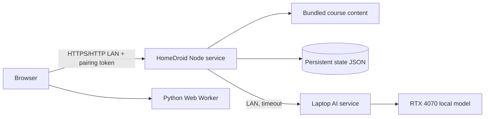

# Kiến trúc hệ thống

## Quyết định chính

- Một Node.js service trên HomeDroid phục vụ cả frontend và API.
- Nội dung khóa học là file tĩnh version-controlled.
- Trạng thái một người dùng lưu trong một JSON document ngoài Git checkout.
- Python cơ bản chạy trong Web Worker ở trình duyệt bằng runtime được bundle cục bộ.
- AI tutor chạy trên laptop và chỉ được gọi qua backend HomeDroid.
- Không thêm database hoặc cloud service cho phiên bản đầu.

## Sơ đồ



## Thành phần

### Frontend

- HTML/CSS/JavaScript modules, không framework ở giai đoạn đầu.
- Routes/views: onboarding, dashboard, module, lesson, review, notes và settings.
- Render Markdown đã được kiểm soát từ nội dung bundled; không render HTML tùy ý từ người dùng.
- Chỉ nạp Python runtime khi người dùng mở bài có code runner.
- AI panel gọi `/api/tutor`; không biết địa chỉ laptop hoặc credential model.

### HomeDroid service

- Đọc `HOST` mặc định `0.0.0.0`, `PORT` và `DATA_DIR` từ environment.
- Phục vụ static assets và JSON API cùng origin.
- Body JSON có giới hạn kích thước.
- Mutation được tuần tự hóa trong process và ghi bằng temp-file + atomic rename.
- State có `revision`; client gửi revision hiện tại để phát hiện ghi đè dữ liệu mới hơn.
- Không dùng state trong Git checkout. Đường dẫn thật phải được xác minh trên runtime; deployment cấu hình `DATA_DIR` tới thư mục persistent, ví dụ `/srv/ai-learning-data`.

### Python runner

- Runtime và package cần thiết được lưu cùng app, không lấy từ CDN.
- Chạy trong Web Worker để không khóa UI.
- Nút Stop terminate worker; lần chạy sau tạo worker mới.
- Giới hạn thời gian, độ dài code và output.
- Không cung cấp filesystem server, shell, socket hoặc secret.
- Chỉ dành cho Python/NumPy và bài dữ liệu nhỏ; PyTorch chạy trên laptop.

### Laptop AI service

- Bind vào IP LAN, không public Internet.
- Cung cấp health endpoint và endpoint chat nội bộ.
- Model backend được chọn lúc triển khai sau khi benchmark VRAM; HomeDroid dùng một adapter HTTP cố định.
- Tutor nhận system policy, lesson excerpt, lịch sử ngắn và câu hỏi.
- Giới hạn context, thời gian và output. Không tự động thực thi code hoặc đọc file tùy ý.
- HomeDroid trả `503 tutor_offline` khi laptop không phản hồi.

## Xác thực và pairing

1. Lần chạy đầu, server tạo pairing key ngẫu nhiên độ entropy cao và chỉ hiển thị một lần trong log/UI HomeDroid phù hợp.
2. Server chỉ lưu hash của key.
3. `POST /api/pair/claim` đổi key lấy session token.
4. Session token được lưu an toàn phía client theo khả năng của môi trường LAN và có thể thu hồi.
5. So sánh secret constant-time; rate-limit claim và tutor.
6. Mọi endpoint state, note, artifact và tutor đều từ chối request chưa xác thực.

Không public app ra Internet. Nếu sau này có HTTPS/Tailscale, đánh giá lại cookie/session; không mặc định coi LAN là đáng tin cậy.

## Mô hình dữ liệu

State là một document có version schema:

```json
{
  "schemaVersion": 1,
  "revision": 0,
  "profile": {
    "displayName": "",
    "startedAt": null,
    "weeklyHours": 3
  },
  "lessons": {
    "m01-w01": {
      "status": "not_started",
      "checks": [],
      "bestQuizScore": null,
      "completedAt": null,
      "artifact": null
    }
  },
  "quizAttempts": [],
  "reviewItems": [],
  "notes": {},
  "activityDays": [],
  "settings": {
    "tutorEnabled": true
  }
}
```

Ràng buộc:

- `status`: `not_started`, `in_progress`, `completed`.
- ID module/lesson/question đến từ content manifest, không do client tùy ý tạo.
- Note và artifact text có giới hạn độ dài.
- Attempt chỉ chứa question ID, lựa chọn, kết quả và timestamp; đáp án chuẩn ở content bundle.
- Streak được suy ra từ `activityDays`, không lưu thêm một giá trị có thể lệch.

## Cấu trúc nội dung

```text
content/
  manifest.json
  modules/
    m01/
      module.json
      w01.md
      w01.quiz.json
      ...
  exercises/
    m01-w01/
      starter.py
      expected.txt
```

`manifest.json` là nguồn thứ tự duy nhất. Schema nội dung được validate khi service khởi động và trong test; content sai làm build/test fail thay vì lỗi lúc học.

## API tối thiểu

| Method | Path | Chức năng |
|---|---|---|
| `GET` | `/api/health` | Trạng thái app, content version và tutor availability |
| `POST` | `/api/pair/claim` | Claim workspace bằng pairing key |
| `POST` | `/api/session/revoke` | Thu hồi session hiện tại |
| `GET` | `/api/state` | Đọc state và revision |
| `PUT` | `/api/state` | Ghi state với expected revision |
| `POST` | `/api/tutor` | Hỏi tutor theo lesson ID |

Không tạo API nhỏ cho từng checkbox ở phiên bản đầu; một state document có optimistic revision đủ cho một người dùng và hai trình duyệt.

## Lỗi và phục hồi

- Revision conflict: trả `409`, client reload state và yêu cầu người dùng áp dụng lại thay đổi vừa làm.
- State hỏng: không ghi đè; giữ file lỗi, phục hồi bản backup gần nhất và báo rõ.
- Tutor offline/timeout: trả lỗi có mã ổn định, UI vẫn giữ câu hỏi nháp.
- Python timeout: terminate worker, giữ code editor và tạo runtime mới khi chạy lại.
- Redeploy: source có thể thay; state không đổi vì nằm trong `DATA_DIR`.

## Backup

- Trước mỗi ghi thành công, giữ một bản backup gần nhất.
- Settings có thao tác export state JSON sau xác thực.
- Import không thuộc phiên bản đầu; phục hồi do quản trị viên thực hiện sau khi validate schema.
